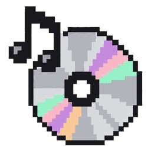

<p align="center">
  
</p>

<h1 align="center">Resonance</h1>

<p align="center">
  <strong>Your music. Your library. Your control.</strong><br />
  A local-first music player for Windows and the browser.
</p>

<p align="center">
  <a href="https://github.com/todouro/resonance/releases/latest">
    
  </a>
  <a href="https://github.com/todouro/resonance/actions/workflows/verify.yml">
    
  </a>
  <a href="https://github.com/todouro/resonance/stargazers">
    
  </a>
  
</p>

<p align="center">
  <a href="https://github.com/todouro/resonance/releases/latest"><strong>Download for Windows</strong></a>
  ·
  <a href="#quick-start">Run from source</a>
  ·
  <a href="https://github.com/todouro/resonance/issues">Report an issue</a>
</p>

---

## About

Resonance is built for people who want a focused listening experience without moving their music library into a cloud service. Organize your local audio, build playlists, edit track details, and manage cover art from one desktop-friendly interface.

The Windows app uses **Tauri 2, React, and TypeScript**. A browser build is also available for lightweight local listening.

## Features

| | What you can do |
|---|---|
| **Local music library** | Scan a music folder, rescan it as your collection changes, and search by song, artist, or album. |
| **Playback controls** | Play and pause, skip tracks, seek, adjust volume, shuffle, and repeat. |
| **Playlists & favorites** | Create playlists, rename or remove them, manage their tracks, and keep your favorites together. |
| **Track details** | Edit supported metadata and manage cover art for your collection. |
| **Keyboard shortcuts** | Control playback with configurable shortcuts. |
| **Audio downloads** | Use the built-in `yt-dlp` workflow, choose an output folder and available audio format, and monitor or cancel downloads. |
| **Desktop storage** | Keep library state and preferences in the Windows app's local user-data storage. |

## Download

**Windows:** get the installer from the [latest GitHub Release](https://github.com/todouro/resonance/releases/latest). Releases may lag behind the unreleased development version on `main`.

The release page contains the available Windows installer formats. For development builds, open [GitHub Actions](https://github.com/todouro/resonance/actions/workflows/verify.yml), choose a successful run, and download its `Resonance-Windows-Setup` artifact. Action artifacts are temporary; use a published Release for a stable download link.

## Quick start

### Requirements

- Node.js **22.12 or later** (Node.js 24 LTS recommended)
- npm
- Git

### Run the browser build

```bash
git clone https://github.com/todouro/resonance.git
cd resonance
npm ci
npm run dev
```

Open [http://localhost:3000](http://localhost:3000).

The browser build is useful for trying the interface, but local file access and persistence differ from the native Windows app.

### Build the Windows desktop app

For a native build, use Windows with the Rust stable toolchain and Microsoft Visual Studio C++ Build Tools installed.

```bash
npm ci
npm run tauri:build:win
```

The NSIS installer is written under `src-tauri/target/release/bundle/nsis/`. Tauri's Windows bundle configuration also supports MSI output when building all configured bundle targets.

## Development commands

| Command | Purpose |
|---|---|
| `npm run dev` | Start the Vite development server on port 3000. |
| `npm test` | Run the automated regression tests. |
| `npm run lint` | Check source code with Oxlint. |
| `npm run build` | Run TypeScript project checks and create a production web build. |
| `npm run preview` | Preview the production web build locally. |
| `npm run tauri:build:win` | Build the Windows NSIS installer. |

Before submitting changes, run the tests, lint, and production build. Changes to desktop behavior should also be exercised in the native app when possible.

## How it is built

- **React 19 + TypeScript** — user interface
- **Vite** — development server and frontend build
- **Zustand** — application state
- **Howler.js** — audio playback
- **Framer Motion** — UI transitions and animation
- **Tauri 2 + Rust** — Windows desktop integration and local storage

## Project principles

- **Local-first:** the music library is centered on files you manage.
- **Focused:** controls and tools are designed around listening and organizing.
- **Transparent:** the repository includes the source and build workflows.
- **Practical:** the browser build and Windows desktop app serve different needs without pretending their file-system capabilities are identical.

## Contributing

Issues and focused pull requests are welcome. For a smoother review:

1. Create a feature branch.
2. Keep the change scoped and explain its user-facing effect.
3. Run `npm test`, `npm run lint`, and `npm run build`.
4. Verify the affected interactions in the browser or Windows app where applicable.

Found a bug or have an idea? [Open an issue](https://github.com/todouro/resonance/issues).

---

<p align="center">
  Made for your local music library.
</p>
